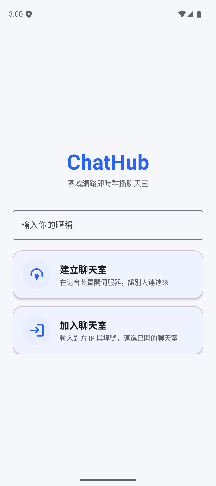
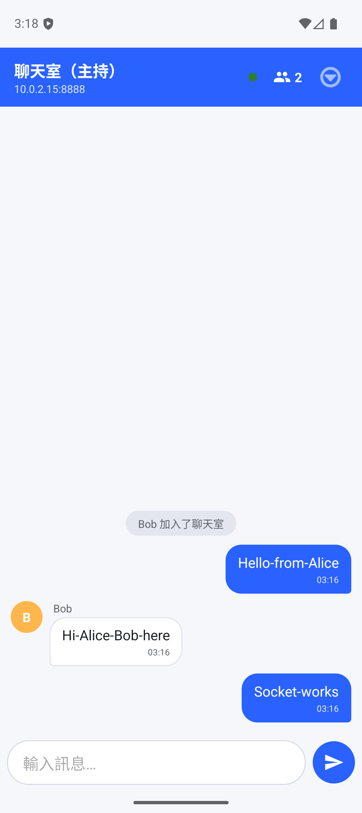
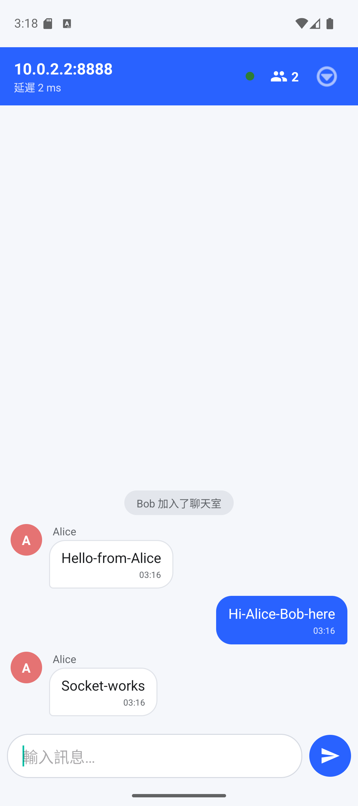

# ChatHub — Android 即時群播通訊系統

> 在 Android 上以**原生 TCP Socket** 自建一套 **JSON 應用層協定**的即時群播聊天系統，
> 具**多執行緒並發**、**在線狀態（presence）管理**與**心跳保活**。
> 刻意不使用 WebSocket / Socket.IO / Firebase，凸顯底層網路與並發能力。

單一 APK 同時能當**伺服器（Host）**或**客戶端（Client）**：進來輸入暱稱、選「建立聊天室」或「加入聊天室」。

| 首頁（選角色） | Host 聊天 | Client 聊天（顯示 RTT） |
|---|---|---|
|  |  |  |

## 功能

**核心（對應原 Socket 聊天室作業）**
- Android `ServerSocket` 多人連線、每連線一條讀執行緒
- 自訂 JSON 協定 + newline 分幀
- 在線成員清單（presence）、加入/離開系統訊息
- 訊息廣播（fan-out），自己/他人/系統三型別泡泡、暱稱頭像、時間戳
- 顯示本機 Server IP/埠
- **優雅關閉**：Client 離開→成員表更新不報錯；Host 關伺服器→Client 顯示「已關閉」不崩潰

**加值亮點**
- **心跳保活**（`PING/PONG`）：逾時自動移除死連線
- **連線延遲（RTT）顯示**：用心跳量來回時間
- **斷線自動重連**（指數退避）+ 連線狀態 banner / 狀態點
- **打字中**指示
- 加入時補送**近期訊息歷史**

## 技術棧

- **語言/UI**：Java、XML layout、Material 3（不使用 Kotlin / Compose）
- **網路**：`java.net.Socket` / `ServerSocket` 原生 TCP、`org.json` JSON、多執行緒（`Thread` + `ExecutorService`）
- **minSdk 25 / targetSdk 36**、Gradle Kotlin DSL

## 快速開始

```powershell
$env:JAVA_HOME = "C:\Program Files\Android\Android Studio\jbr"
.\gradlew.bat :app:assembleDebug --console=plain   # 需看到 BUILD SUCCESSFUL
```

兩台模擬器互連、完整操作與錯誤排查見 **[Docs/TEACHING.md](Docs/TEACHING.md)**。
通訊協定規格見 **[Docs/PROTOCOL.md](Docs/PROTOCOL.md)**。

## 專案結構

```
app/src/main/java/com/example/chathub/
├─ MainActivity.java          首頁/角色選擇
├─ Constants.java             設定常數
├─ net/                       ★ Socket 核心
│  ├─ ChatProtocol.java       協定（單一事實來源）
│  ├─ ChatServer.java         伺服器（accept/廣播/心跳/關閉）
│  ├─ ClientHandler.java      伺服器端單一連線
│  ├─ ChatClient.java         客戶端（連線/讀/送/心跳/重連）
│  └─ ConnectionState.java    連線狀態列舉
├─ model/  ChatMessage, Member
├─ adapter/ MessageAdapter, MemberAdapter
├─ ui/     HostSetupActivity, JoinSetupActivity, ChatActivity
└─ util/   NetworkUtils, TimeFormat, AvatarUtils
```
