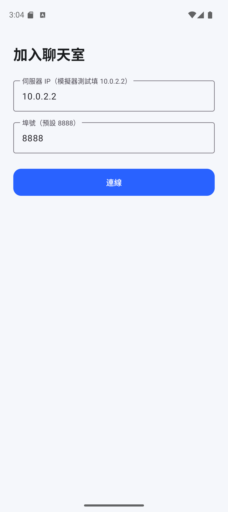
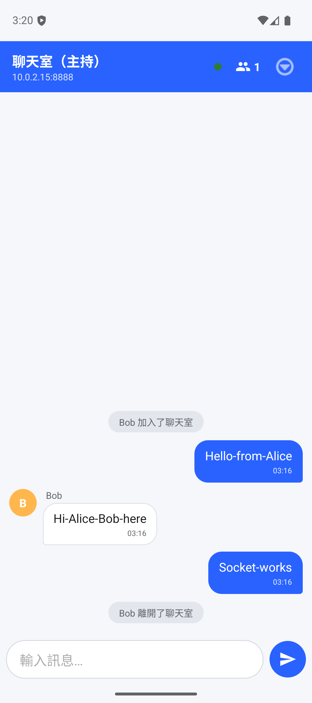
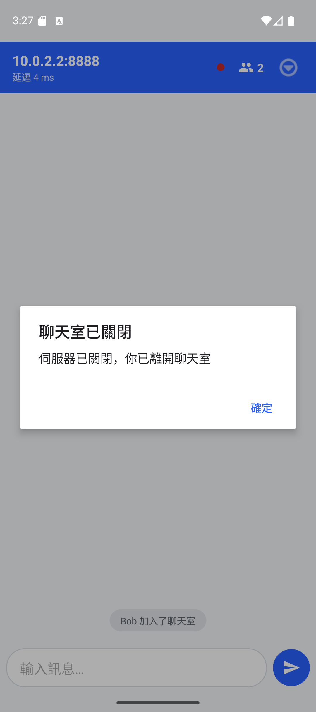

# ChatHub — Android 區域網路即時通訊

ChatHub 是一款以 Java 開發的 Android 區域網路群組即時通訊應用。單一 APK 可於 Host 或 Client 模式運作，透過區域網路即時交換訊息。通訊核心採用原生 TCP Socket 與自訂 JSON 協定，整合連線管理、成員狀態同步、訊息廣播、心跳量測及連線生命週期處理。

系統將 Android UI、網路服務與應用層協定分層，分別處理互動呈現、Socket 傳輸與訊息格式，並為連線狀態與功能模組提供清楚的實作邊界。

## 產品畫面

| 角色選擇 | Host 聊天室 | Client 聊天室與 RTT |
|---|---|---|
|  |  |  |

| Host 連線資訊 | Client 連線設定 |
|---|---|
|  |  |

| Client 離開後的成員狀態 | Host 關閉後的 Client 狀態 |
|---|---|
|  |  |

## 功能與工程設計

- **Host／Client 雙角色**：同一個 Android App 可建立聊天室，也可輸入伺服器位址加入。
- **TCP 多連線服務**：Host 使用 `ServerSocket` 接受多個 Client 連線，並將訊息轉送至聊天室成員。
- **JSON 訊息協定**：以換行分幀傳送 JSON 訊息，統一處理加入、訊息、成員清單、打字狀態、心跳與伺服器關閉等事件。
- **即時成員狀態**：連線、離開與名單更新都會反映在聊天室畫面。
- **連線監測與復原**：`PING/PONG` 心跳用於存活偵測與 RTT 估算；連線中斷時以指數退避策略重連。
- **一致的結束流程**：Client 離開時 Host 移除該連線；Host 關閉時先通知 Client，再安全終止服務。
- **訊息呈現**：支援近期訊息補送、打字中狀態、訊息時間與成員識別。

## 架構

```text
Android App
├─ UI：角色選擇、Host／Client 設定、聊天室與成員狀態
├─ Network：ChatServer、ClientHandler、ChatClient
└─ Protocol：ChatProtocol（JSON 封裝、解析與 newline framing）

Host：ServerSocket → ClientHandler → Room Broadcast
Client：Socket ↔ JSON Lines ↔ ChatServer
```

網路 I/O 在背景執行緒處理；伺服器端為每條連線配置讀取處理程序，所有訊息依協定序列化與分幀，再由 Host 廣播給聊天室成員。

## 技術規格

| 項目 | 採用技術 |
|---|---|
| 平台 | Android，minSdk 25、compileSdk 36、targetSdk 36 |
| 語言與介面 | Java、XML Layout、Material Components |
| 網路 | `java.net.Socket`、`ServerSocket`、TCP、`ExecutorService` |
| 訊息格式 | Android `org.json`、newline-delimited JSON |
| 建置 | Gradle Kotlin DSL、Java 11 |

## 建置與連線

在 Android Studio 專案根目錄建置 Debug APK：

```powershell
if (-not $env:JAVA_HOME) {
    $env:JAVA_HOME = Join-Path $env:ProgramFiles 'Android\Android Studio\jbr'
}
.\gradlew.bat :app:assembleDebug --console=plain
```

真機連線時，Host 與 Client 使用同一個 Wi-Fi 網路；Client 輸入 Host 設定畫面顯示的區域網路 IP 與埠號。

兩台 Android 模擬器在同一台電腦上互連時，先執行：

```powershell
scripts\emu_connect.bat <HOST_SERIAL> [PORT]
```

接著在 Client 輸入 `10.0.2.2` 與相同埠號。設定細節、執行診斷與操作流程見 [執行與維護指南](Docs/OPERATIONS.md)。

## 技術文件

- [網路與連線架構](Docs/ARCHITECTURE.md)：TCP/IP、Socket、NAT、執行緒與 ChatHub 實作對照。
- [執行與維護指南](Docs/OPERATIONS.md)：建置、裝置連線、操作步驟與診斷方式。
- [JSON over TCP 協定規格](Docs/PROTOCOL.md)：訊息型別、欄位、生命週期與並發模型。

## 系統範圍

目前採用單一聊天室；訊息歷史保存在 Host 執行期間的記憶體中，伺服器重啟後不保留。暱稱可重複。這些範圍讓目前版本聚焦於 LAN 即時通訊、協定設計及連線管理流程。

## 專案結構

```text
app/src/main/java/com/example/chathub/
├─ MainActivity.java          角色選擇與進入流程
├─ Constants.java             網路與聊天室設定
├─ net/
│  ├─ ChatProtocol.java       JSON 協定
│  ├─ ChatServer.java         連線接受、廣播、心跳與關閉
│  ├─ ClientHandler.java      單一 Client 連線處理
│  ├─ ChatClient.java         連線、收送、心跳與重連
│  └─ ConnectionState.java    連線狀態模型
├─ model/                     ChatMessage、Member
├─ adapter/                   訊息與成員列表呈現
├─ ui/                        Host、Client 設定與聊天室畫面
└─ util/                      網路資訊、時間與頭像工具
```
